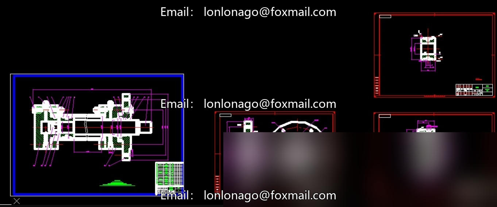
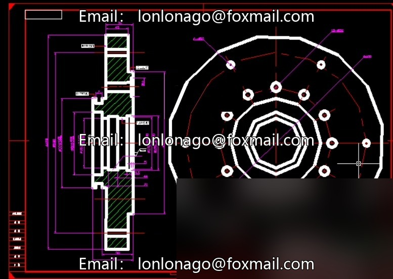

# Hydraulic pressure machine hydraulic system design; hydraulic pressure machine hydraulic system design; hydraulic pressure machine hydraulic system design

## Body

Hydraulic pressure machine hydraulic system design; hydraulic pressure machine hydraulic system design; hydraulic pressure machine hydraulic system design diagram; hydraulic pressure machine hydraulic system design CAD diagram
This document contains CAD diagrams and manuals:
Work cycle is "fast advance → stroke advance → press holding → fast retreat", and basic design parameters are as follows: Parameter category Parameter value Parameter category Parameter value Fast advance stroke 0.4m Press holding pressure 1000kN Stroke advance stroke 0.2m Mechanical efficiency 0.95 Speed of fast advance and fast retreat 1m/min Volumetric efficiency 0.88 Stroke advance speed 0.2m/min Mass of moving parts 200kg Requirements of the problem: 1. Driving device: lower down-pressing single rod piston cylinder, variable buffer at the return end;

2. Installation method: installation at the flange on the front of the cylinder body, piston rod movement;
3. Speed control method: fast forward, fast retreat are differential connection of the oil cylinder, the work process is oil back throttling speed control, when stopping the oil cylinder maintains internal controlled balance.
Design requirements: 1. Conduct condition analysis and calculation, draw condition diagrams (including velocity diagram, load diagram).
2. Draft hydraulic system principle diagram, select standard hydraulic components, draw electromagnetic iron action cycle table.
3. Hydraulic cylinder design calculation, drawing.
519

The material includes hydraulic system design diagrams, CAD figures, and documents such as assembly drawings, flanges, and H018.

<!-- AI_ENRICHED -->

## Images

## Payment

Here is a pay link on Stripe ( https://buy.stripe.com/3cs8yP7sY87d0vu9AB ). Please contact me lonlonago@foxmail.com after funding $89, and I will send you a complete data files , thank you!

